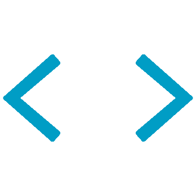
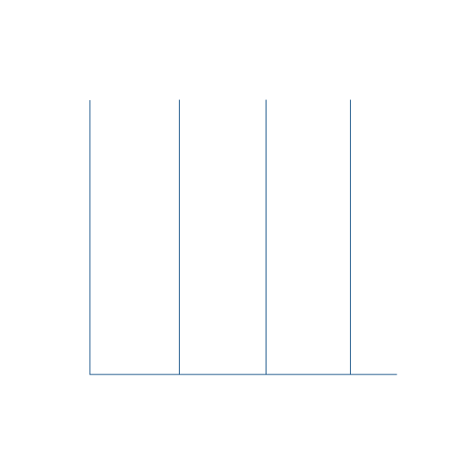
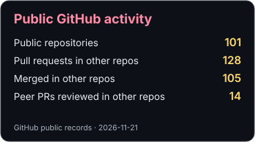
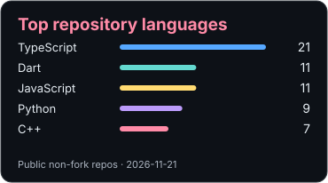
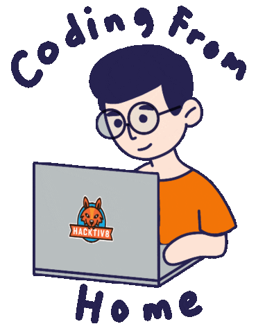
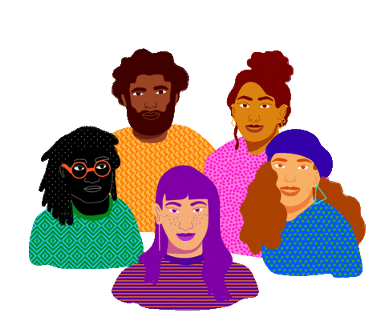

<div align="center">

<!-- Animated Header with Capsule Render -->


<!-- Animated Wave Hello -->


<!-- Social Badges with Glow Effect -->
<br/>
<a href="https://www.linkedin.com/in/chinmay-shringi/">
  
</a>
<a href="https://github.com/ChinmayShringi">
  
</a>
<a href="https://chinmayshringi.web.app/">
  
</a>
<a href="mailto:cs7810@nyu.edu">
  
</a>
  <a href="https://medium.com/@chinmayshringi4">
    
  </a>
  <a href="https://medium.com/feed/@chinmayshringi4">
    
  </a>

<p><strong>Researcher at NYU OSIRIS Lab</strong> · IC3 researcher at Cornell Tech · AWS Certified Cloud Practitioner</p>

<p><a href="#user-content-open-source-contributions">Open-source contributions</a> · <a href="#user-content-research-publications">Research publications</a> · <a href="https://chinmay-systems-atlas.vercel.app/">Personal website</a></p>


</div>


## 🤖 $ whoami

```typescript
const chinmay = {
  location: "📍 New York, NY",
  education: "🎓 M.S. @ NYU (2024-2026)",
  roles: [
    "🔬 Research Developer @ Scrypted Inc.",
    "🔐 Security Researcher @ NYU",
    "🏆 IC3 Researcher @ Cornell Tech"
  ],
  certifications: ["AWS CLP", "CCNA"],
  expertise: {
    frontend: ["React", "Next.js", "Angular", "Vue"],
    backend: ["Spring Boot", "Node.js", "NestJS", "Go"],
    cloud: ["AWS", "Docker", "Kubernetes"],
    security: ["Pentesting", "ZK Proofs", "Hardware Trojans"],
    database: ["PostgreSQL", "MongoDB", "Redis", "Elasticsearch"]
  },
  currentFocus: "Architecting secure & scalable enterprise solutions",
  architecture: ["Microservices", "Event-Driven", "Serverless"],
  funFact: "I benchmark LLMs by making them hack firewalls 🔥",
  dailyRoutine: {
    coffee: "∞",
    code: "24/7",
    debug: "console.log('🔍')",
    repeat: true
  },
  motto: "It works on my machine! 🤷‍♂️ Let's containerize it! 🐳"
};
```

> When I'm not coding, I'm probably thinking about coding... or coffee ☕

<br clear="right"/>


<!-- public-contributions:start -->
## Open-source contributions

- **Lind Project.** I contributed 89 merged pull requests across RawPOSIX, lind-wasm, and lind-docs. I fixed memory-mapping error handling and memory-protection alignment, and added deterministic signal tests. [Memory mapping](https://github.com/Lind-Project/lind-wasm/pull/494) · [Memory protection](https://github.com/Lind-Project/lind-wasm/pull/513) · [Signal tests](https://github.com/Lind-Project/lind-wasm/pull/658)
- **Spotlight Defensive Cyber Benchmark.** I coauthored the 39-scenario study of whether AI can diagnose and repair security faults while keeping legitimate services running. [Paper](https://spotlight-benchmark-public.s3.us-east-2.amazonaws.com/public/spotlight-defensive-cyber-benchmark-preprint-v1.1.pdf) · [Open-source offline edition](https://github.com/spotlight-security-ai/offline-benchmark)
- **Reflex.** Two of my changes were merged into the Python web framework. One gives developers clearer errors for invalid plugin configuration. The other updates how browser pages handle unloading. [Plugin validation](https://github.com/reflex-dev/reflex/pull/6445) · [Page lifecycle](https://github.com/reflex-dev/reflex/pull/6479)
- **SourceSnap and MicroFish-En.** I reduced the permissions requested by the SourceSnap browser extension. I also maintain an English translation of MiroFish and bring upstream changes into that translation. [SourceSnap permission change](https://github.com/ChinmayShringi/sourcesnap/commit/5a764e831b8b2923651577bd3cf722fccce0c417) · [MicroFish-En translation update](https://github.com/ChinmayShringi/MicroFish-En/commit/7fa91020bdea19bb50f8a5570383799cfc374b47) · [Original MiroFish](https://github.com/666ghj/MiroFish)

Across public repositories owned by others, 105 of my pull requests were merged as of November 21, 2026. [See merged pull requests](https://github.com/search?q=is%3Apr+is%3Apublic+is%3Amerged+author%3AChinmayShringi+-user%3AChinmayShringi&type=pullrequests)

<details>
<summary>Upstream open-source projects where my changes were merged or committed</summary>

| Project | My contribution |
| --- | --- |
| Lind Project | 62 merged PRs in [RawPOSIX](https://github.com/Lind-Project/RawPOSIX/pull/24), 26 in [lind-wasm](https://github.com/Lind-Project/lind-wasm/pull/513), and one [lind-docs README update](https://github.com/Lind-Project/lind-docs/pull/9). |
| Reflex | Two merged PRs covering [plugin configuration](https://github.com/reflex-dev/reflex/pull/6445) and the [browser page lifecycle](https://github.com/reflex-dev/reflex/pull/6479). |
| Coro | Five merged PRs, including a [fix for WebSocket reconnects and per-room roles](https://github.com/rahilsinghi/Coro/pull/5). |
| askNYC | Three merged PRs, including [WebSocket and session persistence](https://github.com/rahilsinghi/askNYC/pull/1) and the [3D map dashboard](https://github.com/rahilsinghi/askNYC/pull/7). |
| Apex | Added a [command hint for unrecognized home-screen input](https://github.com/pensarai/apex/pull/123). |
| VoiceAI | Integrated [frontend changes and corrected absolute imports](https://github.com/BMG2001nyu/VoiceAI/pull/8). |
| LockMicrowatt | Updated the [project README](https://github.com/zwangsyc/LockMicrowatt/pull/1). |
| DeFi ZKP Governance | Removed [checked-in dependency files](https://github.com/bblackheart013/defi-zkp-governance-nyu/pull/2). |
| Distributed Computing | Implemented [gRPC job management and a web interface for submitting and monitoring jobs](https://github.com/sariyarizwan/distributed-computing/commit/f9baa6545a1d3964da8034e3c8979cad16df9530). |
| Scrypted AI hackathon | Fixed the [frontend build configuration](https://github.com/scryptedai/hackathon/commit/de58e469f5d43434c32b0698db703a68ff797e15) for the Coinbase CDP demo. |

</details>

<details>
<summary>Reviews, reports, and proposed changes</summary>

| Project | Public record |
| --- | --- |
| Lind Project | Reviewed 14 pull requests by other contributors across [TriSeal](https://github.com/Lind-Project/TriSeal/pull/5#pullrequestreview-3003631914), [RawPOSIX](https://github.com/Lind-Project/RawPOSIX/pull/14), and [lind-wasm](https://github.com/Lind-Project/lind-wasm/pull/796#pullrequestreview-3835877993). Also reported a [process-wait discrepancy](https://github.com/Lind-Project/lind-wasm/issues/625). |
| FOSSology | Proposed [scheduler email-client changes](https://github.com/fossology/fossology/pull/3317) and an [alternative mail tool](https://github.com/fossology/fossology/pull/3319). Both PRs closed without merging. |
| Shannon | Proposed [custom endpoint documentation](https://github.com/KeygraphHQ/shannon/pull/83) and a [worker refresh when changing repositories](https://github.com/KeygraphHQ/shannon/pull/84). Both PRs closed without merging. |
| Heart Disease Prediction | Opened a [PR adding F1, recall, and precision metrics](https://github.com/Dhruv590/Heart-Disease-prediction-EDA-Model/pull/1). |

</details>

<details>
<summary>Other public collaborations</summary>

These public projects have mixed licensing or no project-wide open-source license I could verify.

| Projects | My contribution |
| --- | --- |
| [Neon Exchange](https://github.com/sariyarizwan/neon-exchange/pull/2) | Two merged PRs integrating the backend and voice features. |
| [Etch inference hackathon](https://github.com/dalfindata/etch-inference-hktn/pull/8) | Coauthor credit on the merged SalienceCompact benchmark change. |
| [Lind WebAssembly documentation](https://github.com/Lind-Project/lind-wasm-docs/pull/22) and [Spotlight website](https://github.com/spotlight-security-ai/spotlight-website/pull/16) | Proposed documentation and pricing-page changes respectively. Both PRs closed without merging. |
| [Kadra](https://github.com/Sachin123456790/kadra/commits?author=ChinmayShringi), [SEO Tool Pulse](https://github.com/BMG2001nyu/SEO_tool_Pulse_Hack/commits?author=ChinmayShringi), and [CDP Smart Accounts](https://github.com/scryptedai/cdp-smart-accounts/commit/d01b88c9264a3e5a6ac468b59c7071cf637ab68e) | Authored commits in repositories with component-specific license declarations. |
| [Appointment Manager](https://github.com/vivekrekhadia/Appointment-manager-app/commits?author=ChinmayShringi), [Employee Management](https://github.com/HemantRana01/Employee-Management/commits?author=ChinmayShringi), [login_page_ts_redux](https://github.com/RenishSalakhana/login_page_ts_redux/commits?author=ChinmayShringi), [neural-network-jailbreak](https://github.com/fzinnah17/neural-network-jailbreak/commits?author=ChinmayShringi), and [Chibi SQL API](https://github.com/scryptedai/hackthon-chibi-sql-api/commits?author=ChinmayShringi) | Authored commits. |
| [Food Ordering App Flutter](https://github.com/iamyogik/Food-Ordering-App-Flutter/issues/2#issuecomment-844221191) | Participated in a setup issue discussion. |

</details>

<details>
<summary>Open-source work under my GitHub account</summary>

Each project below has a public commit credited to this account. The links open the repository or, where noted, the original project.

- **AI and research.** [ai-accelerated-hardware](https://github.com/ChinmayShringi/ai-accelerated-hardware) · [AutoAccel-Microwatt](https://github.com/ChinmayShringi/AutoAccel-Microwatt) · [FarmCNN](https://github.com/ChinmayShringi/FarmCNN) · [ema-signal-pipeline](https://github.com/ChinmayShringi/ema-signal-pipeline) · [persona-ai](https://github.com/ChinmayShringi/persona-ai) · [slm-swarm](https://github.com/ChinmayShringi/slm-swarm) · [shoemaker-elves](https://github.com/ChinmayShringi/shoemaker-elves) · [one-shot-compression](https://github.com/ChinmayShringi/one-shot-compression).
- **Developer tools and apps.** [freePDF](https://github.com/ChinmayShringi/freePDF) · [PitchPilot](https://github.com/ChinmayShringi/PitchPilot) · [snapdeck](https://github.com/ChinmayShringi/snapdeck) · [watch-dot-voice](https://github.com/ChinmayShringi/watch-dot-voice) · [whisperglass](https://github.com/ChinmayShringi/whisperglass) · [KindredTails](https://github.com/ChinmayShringi/KindredTails) · [TermiteFabrications](https://github.com/ChinmayShringi/TermiteFabrications) · [StreamOS](https://github.com/ChinmayShringi/StreamOS).
- **Web and graphics.** [AngularShoelace](https://github.com/ChinmayShringi/AngularShoelace) · [CRUDServer](https://github.com/ChinmayShringi/CRUDServer) · [javascript_task](https://github.com/ChinmayShringi/javascript_task) · [jsImageManipulation](https://github.com/ChinmayShringi/jsImageManipulation) · [MongoImageCRUD](https://github.com/ChinmayShringi/MongoImageCRUD) · [MulterNode](https://github.com/ChinmayShringi/MulterNode) · [Node-ejs-mongodb-Login](https://github.com/ChinmayShringi/Node-ejs-mongodb-Login) · [pizzaTemplateReact](https://github.com/ChinmayShringi/pizzaTemplateReact) · [ReactCRUD](https://github.com/ChinmayShringi/ReactCRUD) · [threeDModel](https://github.com/ChinmayShringi/threeDModel) · [threejsCourse](https://github.com/ChinmayShringi/threejsCourse).
- **Flutter and mobile.** [Cart_Flutter_ui](https://github.com/ChinmayShringi/Cart_Flutter_ui) · [CoffeeHouse_FlutterUI](https://github.com/ChinmayShringi/CoffeeHouse_FlutterUI) · [Connect_Flutter](https://github.com/ChinmayShringi/Connect_Flutter) · [ConnectFirebase](https://github.com/ChinmayShringi/ConnectFirebase) · [CovidTracker](https://github.com/ChinmayShringi/CovidTracker) · [flutter_slide_animation](https://github.com/ChinmayShringi/flutter_slide_animation) · [FoodApp_FlutterUi](https://github.com/ChinmayShringi/FoodApp_FlutterUi) · [NeuMorph_Calculater_FlutterUI](https://github.com/ChinmayShringi/NeuMorph_Calculater_FlutterUI) · [NeuMorphFlutter](https://github.com/ChinmayShringi/NeuMorphFlutter) · [Plant_FlutterUI](https://github.com/ChinmayShringi/Plant_FlutterUI) · [Plant_SideNav_FlutterUI](https://github.com/ChinmayShringi/Plant_SideNav_FlutterUI) · [theBarber_FlutterUI](https://github.com/ChinmayShringi/theBarber_FlutterUI) · [TimeZone](https://github.com/ChinmayShringi/TimeZone) · [Water_level](https://github.com/ChinmayShringi/Water_level).
- **C++.** [C-PeriodicTable](https://github.com/ChinmayShringi/C-PeriodicTable).

- **Translations and related repositories.** [MicroFish-En](https://github.com/ChinmayShringi/MicroFish-En) is my English translation of [MiroFish](https://github.com/666ghj/MiroFish). [SourceSnap](https://github.com/ChinmayShringi/sourcesnap) and [source-navigator](https://github.com/ChinmayShringi/source-navigator) are related extension repositories. My [Coinbase CDP demo](https://github.com/ChinmayShringi/hackathon-) is also listed above under the Scrypted AI hackathon.
- **Template imports.** My [NestJS](https://github.com/ChinmayShringi/nestjs-boilerplate) and [Next.js](https://github.com/ChinmayShringi/nextjs-boilerplate) repositories are imports of the [brocoders](https://github.com/brocoders/nestjs-boilerplate) and [ixartz](https://github.com/ixartz/Next-js-Boilerplate) templates, respectively.
- **Work on a fork.** I [updated the README](https://github.com/ChinmayShringi/Skype-Clone/commit/ddcdeae8d8473ff6bbb0814d4e1aaae99438a54f) on my fork of [Ronak99’s Skype-Clone](https://github.com/Ronak99/Skype-Clone). Forks used to submit upstream PRs appear under their upstream projects above.

</details>
<!-- public-contributions:end -->

## 🚀 Mission Control

<div align="center">

| 🎯 Current Focus | 📌 Status |
|:---|:---:|
| 🔭 Orchestrating microservices like a symphony conductor | `ACTIVE` |
| 🔒 Building next-gen secure virtualization @ Lind VM | `ACTIVE` |
| 🤖 Benchmarking LLMs as cybersecurity analysts | `ACTIVE` |
| 🌱 Learning something new every `git commit` | `ALWAYS` |
| 👯 Looking to collaborate on security & scalability projects | `OPEN` |
| 💡 Building solutions that scale faster than my coffee consumption | `∞` |
| 🎯 Goal: Write code so clean Disney would approve | `IN PROGRESS` |
| ⚡ Fun fact: I speak multiple languages, but JavaScript is my favorite! | `TRUE` |

</div>


##  Tech Arsenal

<div align="center">

### ⚔️ Languages & Core
<a href="https://skillicons.dev">
  
</a>

### 🎨 Frontend Sorcery
<a href="https://skillicons.dev">
  
</a>

### ⚙️ Backend Wizardry
<a href="https://skillicons.dev">
  
</a>

### 🗄️ Databases & Data
<a href="https://skillicons.dev">
  
</a>

### ☁️ Cloud & DevOps
<a href="https://skillicons.dev">
  
</a>

### 🛡️ Security & Tools
<a href="https://skillicons.dev">
  
</a>

### 📱 Mobile & IoT
<a href="https://skillicons.dev">
  
</a>

</div>

##  GitHub Analytics

<div align="center">

<a href="https://github.com/search?q=is%3Apr+is%3Apublic+author%3AChinmayShringi+-user%3AChinmayShringi+is%3Amerged&amp;type=pullrequests">
  
</a>
<a href="https://github.com/ChinmayShringi?tab=repositories">
  
</a>

<br/>

<!-- Activity Graph -->
<a href="https://github.com/ChinmayShringi">
  
</a>

<!-- GitHub Profile Summary Cards -->
<br/>


</div>


## 🐍 Contribution Snake

<div align="center">

<!-- Snake Animation -->
<picture>
  <source media="(prefers-color-scheme: dark)" srcset="./docs/assets/contribution-snake-dark.svg">
  <source media="(prefers-color-scheme: light)" srcset="./docs/assets/contribution-snake-light.svg">
  
</picture>

<a href="https://github.com/users/ChinmayShringi/contributions">View my contribution calendar on GitHub</a>

</div>

## 🔥 Featured Projects

<div align="center">

<!-- Project Cards with Animations -->
<table>
<tr>
<td width="50%">

### 🔒 Lind Virtual Machine
<a href="https://github.com/Lind-Project/lind-wasm">
  
  
  
</a>

> 🛡️ Next-gen OS security with cage-based isolation
- POSIX-compliant syscalls with memory safety
- 25% improved system reliability
- Microvisor architecture

</td>
<td width="50%">

### 🤖 OMNI - LLM Cyber Range
  
  
  

> 🎯 Benchmarking LLMs as Security Analysts
- Dockerized cyber range environments
- Firewall misconfiguration detection
- Network topology modeling

</td>
</tr>
<tr>
<td width="50%">

### ⚡ CRPC Consensus Protocol
<a href="https://github.com/ChinmayShringi/crpc-ring-visualizer">
  
  
  
</a>

> 🔗 IC3 Research @ Cornell Tech
- First working CRPC implementation
- 3D visualization with Three.js
- Adversarial node behavior modeling

</td>
<td width="50%">

### 💰 Credilio - FinTech Platform
  
  
  

> 📊 AI-Powered Financial Services
- 1M+ downloads
- Multi-party integration
- Real-time analytics

</td>
</tr>
<tr>
<td width="50%">

### 🎥 Bozu - Video Platform
  
  
  

> 📹 Enterprise Video Conferencing
- Custom media routing
- Real-time communication
- Scalable architecture

</td>
<td width="50%">

### ⚡ Helios - Trading Platform
  
  
  

> 💹 High-Frequency Trading Engine
- 100,000+ TPS
- Sub-millisecond latency
- 99.99% uptime

</td>
</tr>
<tr>
<td width="50%">

### 🏠 TermiteFabrications
<a href="https://github.com/ChinmayShringi/TermiteFabrications">
  
  
  
</a>

> 🏗️ 3D Home Building Platform
- Immersive 3D visualization
- AR product placement
- Real-time customization

</td>
<td width="50%">

### 🏥 Doccine Healthcare
  
  
  

> 🩺 Practice Management Platform
- Nationwide provider network
- Digital health records
- Patient care optimization

</td>
</tr>
</table>

</div>

## 🏗️ More Epic Projects

```typescript
const projects = {
  featured: {
    "🔒 Lind Project": {
      tech: ["Rust", "C", "WebAssembly"],
      highlight: "Secure System Architecture with Cage Isolation",
      impact: "25% reliability improvement"
    },
    "🤖 AIPES": {
      tech: ["Java", "Next.js", "PostgreSQL"],
      highlight: "AI-driven Managerial Training Simulations",
      impact: "Real-time feedback & analytics"
    },
    "💳 Credel": {
      tech: ["React", "Node.js", "Adonis.js"],
      highlight: "Credit & Loan Management System",
      impact: "40% reduction in processing time"
    }
  },
  current: {
    "🚀 Enterprise Scale Apps": "Microservices with Spring Boot & Cloud",
    "🌐 Real-time Platform": "WebRTC & Socket.io implementation",
    "📱 Cross-Platform Apps": "React Native & Flutter masterpieces",
    "🔐 Security Research": "Hardware Trojans & ZK Bridges"
  },
  upcoming: "More exciting projects in the pipeline! 🚀"
};
```

## Research publications

### Conference publications

- **GRAFT: gRPC-Routed Agent Framework for Tasking in Edge and Personal Devices**. Chinmay Shringi, Alon Hillel-Tuch, and Sariya Rizwan. ACM Conference on AI and Agentic Systems (CAIS 2026), pp. 1204–1212. [ACM paper](https://doi.org/10.1145/3786335.3813216) · [Open PDF](https://openreview.net/pdf?id=AHUfHheG4V)
- **Branch-Commit-Validate: A Git-Inspired Workflow for Autonomous Red-Team Agents**. Chinmay Shringi, Alon Hillel-Tuch, and Sariya Rizwan. Poster research paper at CSCE 2025, published in 2026 in Springer's *Communications in Computer and Information Science*, vol. 2937, pp. 525–530. [Springer paper](https://doi.org/10.1007/978-3-032-22208-4_37)
- **An Advanced AI-Driven Database System**. Mary Tedeschi, Sariya Rizwan, Chinmay Shringi, Vaibhav Devram Chandgir, and Sergio Belich. EDULEARN25, pp. 5130–5139 (2025). [IATED paper](https://doi.org/10.21125/edulearn.2025.1294) · [arXiv 2507.17778](https://arxiv.org/abs/2507.17778) · [City Tech poster program](https://citytech.cuny.edu/annual-poster/docs/poster_2025.pdf) · [Pace research day program](https://csis.pace.edu/~scha/SARD2025/program.html)

### Preprint and technical reports

- **Benchmarking Large Language Models as Defensive Operators in High-Fidelity Networks**. Alex Leader, Chinmay Shringi, and Katharine Mahon Kuzin. Spotlight Defensive Cyber Benchmark preprint, v1.1, July 2026. [Preprint PDF](https://spotlight-benchmark-public.s3.us-east-2.amazonaws.com/public/spotlight-defensive-cyber-benchmark-preprint-v1.1.pdf)
- **Visual Simulation of Algebraic AI Hardware Accelerators**. Chinmay Shringi. Technical report, April 2025. [Read the report](https://github.com/ChinmayShringi/ai-accelerated-hardware/blob/main/report.md)
- **Kindred Tails**. Chinmay Shringi, Hetarth Sangrajka, and Dhruv Desai. Undergraduate project report, Uka Tarsadia University, 2021. [Project repository](https://github.com/ChinmayShringi/KindredTails)

### Related research

- **Zero-Knowledge Proof Bridges for Secure Cross-Chain DeFi**. Directed research with Prof. Ayesha Kiani. I submitted the project abstract to the 2025 Science of Blockchain Conference. [Project description](https://www.linkedin.com/in/chinmay-shringi)
- **SLM Swarm Evaluation System**. A research software project for comparing small language model swarms with a single larger model on dialogue summarization. [Code and evaluation setup](https://github.com/ChinmayShringi/slm-swarm)

## 🏆 Achievements & Recognition

<div align="center">


<br/>


<br/>


### 💪 Impact Metrics

| Metric | Value |
|:---:|:---:|
| 🚀 System Performance Boost | **70%** |
| 💰 Production Cost Reduction | **40%** |
| 📈 API Response Improvement | **60%** |
| 🔄 Deployment Frequency Increase | **55%** |
| ☁️ Cloud Cost Savings | **40%** |
| ⏱️ System Uptime | **99.99%** |

</div>


## Coding time snapshot

<!--START_SECTION:waka-->
```text
🔷 TypeScript   12 hrs 30 mins  ████████████░░░░░  48.2%
🐍 Python       8 hrs 15 mins   ████████░░░░░░░░░  31.8%
🦫 Go           3 hrs 45 mins   ███░░░░░░░░░░░░░░  14.5%
🦀 Rust         1 hr 25 mins    █░░░░░░░░░░░░░░░░   5.5%
```
<!--END_SECTION:waka-->

## 💭 Dev Quote of the Day

<div align="center">


</div>

<br/>

## 💻 Random Dev Joke

<div align="center">


</div>

## 📡 Signal Transmission (Contact)

[Ask a question about my projects or publications](https://github.com/ChinmayShringi/ChinmayShringi/discussions/categories/q-a)

<div align="center">

<a href="https://chinmayshringi.web.app/" target="_blank">
  
</a>
<a href="mailto:cs7810@nyu.edu" target="_blank">
  
</a>
<a href="https://www.linkedin.com/in/chinmay-shringi/" target="_blank">
  
</a>
<a href="https://github.com/ChinmayShringi" target="_blank">
  
</a>

<br/><br/>

### 📬 Quick Connect
```javascript
const contact = {
  email: "cs7810@nyu.edu",
  location: "New York, NY",
  portfolio: "chinmayshringi.web.app",
  availability: "Open for opportunities! 🚀"
};
```

<br/>

<i>"The only way to do great work is to love what you do." - Steve Jobs</i>
<br/>
<i>"Code is like humor. When you have to explain it, it's bad." - Cory House</i>

</div>

## 🤝 Let's Build Something Amazing!

<div align="center">

<br/>
<a href="mailto:cs7810@nyu.edu">
  
</a>
<a href="https://www.linkedin.com/in/chinmay-shringi/">
  
</a>
<a href="https://chinmayshringi.web.app/">
  
</a>
<a href="https://github.com/ChinmayShringi?tab=repositories">
  
</a>
  <a href="https://medium.com/@chinmayshringi4">
    
  </a>
  <a href="https://medium.com/feed/@chinmayshringi4">
    
  </a>

</div>

<div align="center">

<!-- The Classic Coding Guy GIF! -->

<br/>

 <em><b>I love connecting with different people</b> so if you want to say <b>hi, I'll be happy to meet you more!</b> 😊</em>

**⭐ If you like my work, consider giving my repos a star! ⭐**

</div>

